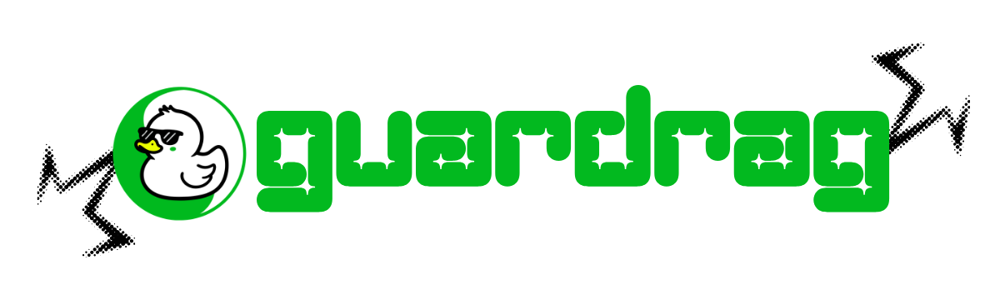

<div align="center">



# 🛡️ GuardRAG

### The 100% Offline, Air-Gapped NotebookLM Alternative
#### Private AI Document Intelligence with Hybrid BM25+Vector Search, PII Redaction & Offline Audio Overviews

[](https://pypi.org/project/guard-rag/)
[](https://www.python.org/)
[](https://ollama.ai)
[](#-hybrid-retrieval-engine-bm25--dense-rrf)
[](#-why-guardrag)
[](https://github.com/sowmiyan-s/GUARD-RAG/blob/main/LICENSE)
[](https://github.com/sowmiyan-s/GUARD-RAG/tree/main/tests)
[](https://github.com/sowmiyan-s/GUARD-RAG/blob/main/Dockerfile)

<br/>

> **Interact with sensitive enterprise documents with zero data leakage, zero cloud dependencies, and verifiable source citations.**  
> Turn confidential PDFs, Excel spreadsheets, PowerPoint decks, and codebases into an interactive knowledge base with local voice briefings, hybrid retrieval, and real-time streaming guardrails.

---

### 🚀 [Quickstart in 60s](#-quickstart-in-60-seconds) • 🎧 [Offline Audio Overview](#-notebooklm-style-offline-audio-overview) • 🔍 [Hybrid Retrieval](#-hybrid-retrieval-engine-bm25--dense-rrf) • 🖥️ [CLI Guide](#️-command-line-interface-cli) • 🏗️ [Architecture](https://github.com/sowmiyan-s/GUARD-RAG/blob/main/docs/ARCHITECTURE.md) • 📚 [Full Docs](https://github.com/sowmiyan-s/GUARD-RAG/blob/main/docs/README.md)

</div>

---

## 📋 Table of Contents

- [📖 Overview & Why GuardRAG?](#-overview)
- [⚖️ Feature Comparison Matrix (vs NotebookLM & Cloud AI)](#️-feature-comparison-matrix)
- [🌟 What's New in v1.3.2](#-whats-new-in-v132)
- [🎧 NotebookLM-Style Offline Audio Overview](#-notebooklm-style-offline-audio-overview)
- [🔍 Hybrid Retrieval Engine (BM25 + Dense RRF)](#-hybrid-retrieval-engine-bm25--dense-rrf)
- [⚡ Quickstart in 60 Seconds](#-quickstart-in-60-seconds)
- [🖥️ Command Line Interface (CLI)](#️-command-line-interface-cli)
- [📁 Universal Document & Folder Ingestion](#-universal-document--folder-ingestion)
- [🛡️ 4-Tier Safety Guardrails Matrix](#️-4-tier-safety-guardrails-matrix)
- [🏗️ System Architecture & Data Flow](#️-system-architecture--data-flow)
- [🐍 Python SDK Integration](#-python-sdk-integration)
- [🌐 Secure Multi-Device LAN Collaboration](#-secure-multi-device-lan-collaboration)
- [🎭 Reasoning Profiles & Custom Personas](#-reasoning-profiles--custom-personas)
- [📊 Performance Benchmarks](#-performance-benchmarks)
- [📚 Documentation Ecosystem](#-documentation-ecosystem)
- [🧪 Testing & Validation](#-testing--validation)
- [🤝 Contributing & Community](#-contributing--community)
- [📄 License & Author](#-license--author)

---

## 📖 Overview

**GuardRAG** is a production-grade, self-hosted, air-gapped Retrieval-Augmented Generation (RAG) system engineered for organizations with strict compliance, security, and data privacy mandates. Built for **Legal, Healthcare, Finance, Defense, and Enterprise IT**, GuardRAG eliminates the privacy risks of cloud AI by running the entire document ingestion, vectorization, reasoning, and speech synthesis pipeline locally.

### Why Choose GuardRAG?

- 🔒 **100% Offline & Air-Gapped**: Zero cloud API dependencies. No telemetry, tracking, external fonts, or external speech APIs.
- 🎧 **Offline Audio Overview**: Built-in voice player using the browser's native Web Speech API to listen to document briefings without sending audio bytes to any cloud provider.
- 🔍 **Hybrid Retrieval (BM25 + Dense Vector RRF)**: Combines exact keyword matching (for invoice numbers, error codes, legal clauses) with dense semantic understanding via Reciprocal Rank Fusion.
- 🛡️ **4-Tier Cumulative Guardrails**: Real-time ISO/IEC 7812 Luhn-validated credit card filtering, SSN masking, API credential redaction, and anti-jailbreak defenses.
- ⚡ **Zero-Leak Streaming**: Pre-buffered 32-character sliding lookahead window prevents sensitive tokens from ever touching the network over SSE streams.
- 📁 **Universal Multi-Format Ingestion**: Ingest PDFs, Word (`.docx`), Excel spreadsheets (`.xlsx`), PowerPoint slides (`.pptx`), HTML web dumps, and codebases individually or by entire directories.
- 🌐 **Host-Controlled LAN Sharing**: Share document Q&A across local teams with the **Host Authority Principle**—guests enjoy read-only access while the host retains exclusive administrative control.

---

## ⚖️ Feature Comparison Matrix

| Capability | GuardRAG | Google NotebookLM | Cloud AI (ChatGPT / Claude) | PrivateGPT | Bare LangChain |
| :--- | :---: | :---: | :---: | :---: | :---: |
| **100% Offline & Air-Gapped** | ✅ **Native** | ❌ Cloud Only | ❌ Cloud Only | ✅ Yes | ⚠️ Requires Assembly |
| **Data Privacy (Zero Egress)** | ✅ **Absolute** | ❌ Data sent to Google | ❌ Data sent to 3rd party | ✅ Yes | ⚠️ Manual |
| **Audio Overview Briefings** | ✅ **100% Offline TTS** | ✅ Cloud Audio | ❌ Third-party API | ❌ None | ❌ None |
| **Hybrid Search (BM25 + Vector)** | ✅ **Built-in RRF** | ⚠️ Vector-dominant | ⚠️ Black-box | ❌ Dense only | ⚠️ Heavy setup |
| **Multi-Format (Excel / PPTX / HTML)** | ✅ **Native** | ⚠️ Partial | ✅ Yes | ⚠️ Basic PDF | ⚠️ Manual plugins |
| **Recursive Directory Ingestion** | ✅ **`guardrag ./dir/`** | ❌ Manual upload | ❌ Manual upload | ⚠️ CLI flag | ❌ Custom code |
| **Real-Time Lookahead Leak Filter** | ✅ **Built-in (32-char)** | ❌ None | ❌ Post-hoc | ❌ None | ❌ None |
| **Context-Aware PII Redaction** | ✅ **Built-in (4 Tiers)** | ❌ None | ❌ None | ❌ None | ⚠️ Manual Presidio |
| **Setup Friction** | ✅ **1-Line `pip`** | ❌ Google Login | ❌ Subscription | ⚠️ Heavy Setup | ❌ Heavy Coding |

---

## 🌟 What's New in v1.3.2

- 🎧 **Offline Audio Overview**: Listen to AI-generated document briefings using the client's native speech synthesis engine.
- 🔍 **Hybrid Retrieval Engine**: Pure-Python Okapi BM25 index fused with dense vector embeddings via Reciprocal Rank Fusion (RRF).
- 📊 **Extended Document Loaders**: Ingest `.xlsx`, `.xls` (Excel), `.pptx` (PowerPoint), and `.html` / `.htm` (Web dumps).
- 🛡️ **Streaming Lookahead Buffer**: Defuses real-time SSE token leakage with a 32-character pre-inspection window.
- 💳 **Luhn Checksum Validation**: Eliminates false-positive redaction of non-card 16-digit serial numbers and identifiers.
- 🖥️ **Universal CLI & One-Line Commands**: Run `guardrag run`, `guardrag --web`, `guardrag document.pdf`, or `guardrag path/to/folder`. Both `guardrag` and `guard-rag` CLI binaries are supported.
- 📦 **100% Passing Test Suite**: 83 passing unit tests verifying hybrid retrieval, extended loaders, directory indexing, and safety guardrails.

---

## 🎧 NotebookLM-Style Offline Audio Overview

GuardRAG brings the viral **Audio Overview** experience directly into your browser—**100% offline, private, and free**:

1. Ingest any document (PDF, spreadsheet, presentation, or meeting notes).
2. Click the **🎧 Audio Overview** button in the document header.
3. GuardRAG synthesizes a clear, spoken briefing using your browser's native **Web Speech API** (`window.speechSynthesis`).
4. **Key Highlights**:
   - Zero cloud audio generation costs or latency spikes.
   - Zero audio data transmitted across the internet.
   - Natural playback controls: Play, Pause, and Resume with automated sentence boundary chunking.

---

## 🔍 Hybrid Retrieval Engine (BM25 + Dense RRF)

Traditional vector-only RAG systems frequently fail when searching for exact alphanumeric codes, such as invoice numbers (`INV-2026-X88`), server error codes (`ERR-9021`), or legal clause numbers (`Section 4.2(b)`).

GuardRAG combines **dense semantic vector search** with an air-gapped **Okapi BM25 keyword index**:

```
User Query: "What happened with invoice INV-2026-X88?"
                     │
         ┌───────────┴───────────┐
         ▼                       ▼
┌──────────────────┐    ┌──────────────────┐
│  Dense Vector    │    │   Okapi BM25     │
│  Semantic Search │    │   Keyword Search │
└────────┬─────────┘    └────────┬─────────┘
         │                       │
         └───────────┬───────────┘
                     ▼
         ┌───────────────────────┐
         │ Reciprocal Rank       │
         │ Fusion (RRF Scoring)  │
         └───────────┬───────────┘
                     ▼
   Top Precision Citations Delivered
```

- **Dense Retriever**: Captures semantic concepts, synonyms, and high-level conversational intent.
- **BM25 Retriever**: Captures exact alphanumeric codes, SKU numbers, legal clauses, and variable names.
- **Reciprocal Rank Fusion**: Re-ranks candidates using $\text{RRF Score} = \sum \frac{1}{60 + \text{rank}_i}$, ensuring the most accurate chunks rise to the top.

---

## 🌟 Key Features & Capabilities

```
┌─────────────────────────────────────────────────────────────────────────────┐
│                             GUARDRAG CORE CAPABILITIES                     │
├──────────────────────┬──────────────────────┬───────────────────────────────┤
│  🛡️ 100% Air-Gapped  │  ⚡ FastEmbed ONNX   │  🔒 4-Tier Guardrails         │
│  Zero external data  │  Sub-15ms embedding  │  Public, Internal,            │
│  leakage or tracking │  latency on CPU      │  Confidential, Restricted     │
├──────────────────────┼──────────────────────┼───────────────────────────────┤
│  🌊 Live SSE Stream  │  🌐 LAN Sharing      │  🎭 Reasoning Profiles        │
│  Zero perceived lag  │  Host-controlled     │  Balanced, Strict Privacy,    │
│  typewriter output   │  read-only guest UI  │  Fast Executive Summarizer    │
├──────────────────────┼──────────────────────┼───────────────────────────────┤
│  📁 Multi-Format RAG │  🗄️ Pluggable Vector │  📜 Tamper-Proof Audit        │
│  PDF, Word, Code,    │  FAISS (in-memory)   │  SQLite WAL forensic logging  │
│  CSV, JSON, Logs, MD │  & Qdrant (cluster)  │  with ISO-8601 timestamps     │
└──────────────────────┴──────────────────────┴───────────────────────────────┘
```

- 🛡️ **Zero Data Leakage**: Ingested files, vector indexes, and generated tokens reside purely in local storage.
- ⚡ **FastEmbed ONNX Embeddings**: Native C++ SIMD acceleration eliminates bulky 3GB+ PyTorch CUDA downloads.
- 🔒 **Context-Preserving PII Redaction**: Replaces identities with contextual tokens (`[PERSON_1]`, `[EMAIL_1]`) to preserve reasoning flow while shielding raw records.
- 🛡️ **Indirect Prompt Injection Neutralizer**: Defuses hidden Unicode steganography, prompt overrides, and markdown exfiltration payloads embedded in untrusted documents.
- 🌐 **Host-Controlled LAN Collaboration**: Instantly broadcast document Q&A to your office LAN without exposing host controls, file upload forms, or vector settings.
- 🗄️ **Dual Vector Backends**: Flat L2/Cosine similarity search via **FAISS-CPU** (default) or distributed **Qdrant** clusters.
- 🎭 **Tailored Reasoning Personas**: Switch between *Balanced*, *Strict Privacy*, and *Fast Summarizer*, or build custom personas with tuned chunk boundaries.
- 🔌 **Full Python SDK & Headless CLI**: Automated batch document processing, CI/CD document validation, and programmatic RAG pipelines.

---

## 🏗️ System Architecture & Data Flow

GuardRAG enforces end-to-end data isolation across ingestion, retrieval, and generation.

```mermaid
graph TD
    Client(["User Client / Web Dashboard / Headless CLI / LAN Guest"])
    
    subgraph IngestionPipeline ["1. Ingestion & Sanitization Pipeline"]
        Upload["Raw Documents (PDF, DOCX, TXT, CSV, JSON, PY)"] --> Parser["Document Parser & Text Extractor"]
        Parser --> Sanitizer["Indirect Prompt Injection Sanitizer\n(Zero-Width & Payload Stripper)"]
        Sanitizer --> PIIScrubber["Context-Aware PII & Secret Redactor\n([PERSON_1], [EMAIL_1], [KEY_REDACTED])"]
        PIIScrubber --> Chunker["Recursive Semantic Text Splitter"]
        Chunker --> Embedder["FastEmbed ONNX Vectorizer (BAAI/bge-small-en-v1.5)"]
        Embedder --> VectorDB[("Local Vector Store: FAISS / Qdrant")]
    end

    subgraph QueryPipeline ["2. Guarded Retrieval & Generation Pipeline"]
        Client -->|Submit Query| InputGuard["Input Guardrail Inspection\n(DAN & Anti-Jailbreak Filter)"]
        InputGuard -->|Sanitized Query| Retriever["Semantic Vector Retriever (Top-K)"]
        VectorDB -->|Grounded Chunks + Citations| Retriever
        Retriever --> PromptEngine["Persona & Context Prompt Engine"]
        PromptEngine --> LocalLLM["Local LLM via Ollama\n(Llama 3.3 / DeepSeek-R1 / Gemma 3 / Mistral)"]
        LocalLLM -->|Raw Token Stream| OutputGuard["Output Secret & Leakage Filter"]
        OutputGuard -->|Live SSE Stream (:8000)| Client
    end

    subgraph AuditLayer ["3. Forensic Auditing & State"]
        InputGuard -.-> AuditDB[("SQLite WAL Audit & Session Database\nsessions.db")]
        OutputGuard -.-> AuditDB
    end
```

> 📖 **Deep Dive**: For full subsystem architecture, security boundaries, and sequence diagrams, see **[ARCHITECTURE.md](https://github.com/sowmiyan-s/GUARD-RAG/blob/main/docs/ARCHITECTURE.md)**.

---

## 🛡️ 4-Tier Safety Guardrails Matrix

Guardrail tiers can be toggled per session or applied globally. Protections are cumulative:

```
┌─────────────────────────────────────────────────────────────────────────────┐
│  🔴 RESTRICTED (Highest)                                                    │
│  Certified regulatory lock: HIPAA PHI, medical diagnoses, salaries, SSNs    │
├─────────────────────────────────────────────────────────────────────────────┤
│  🟡 CONFIDENTIAL                                                            │
│  Auto-redacts PII: Person names, email addresses, phone numbers, locations  │
├─────────────────────────────────────────────────────────────────────────────┤
│  🔵 INTERNAL                                                                │
│  Blocks credentials: API keys, bearer tokens, passwords, database URIs      │
├─────────────────────────────────────────────────────────────────────────────┤
│  🟢 PUBLIC (Baseline)                                                       │
│  Neutralizes prompt injection, DAN mode, jailbreaks. Zero text masking      │
└─────────────────────────────────────────────────────────────────────────────┘
```

| Tier | Sensitivity | Enforced Protections | Recommended Use Case |
| :---: | :---: | :--- | :--- |
| 🟢 | **Public** | Baseline anti-jailbreak, DAN neutralization, prompt injection defense. No text masking. | Public documentation, open-source codebases, marketing whitepapers |
| 🔵 | **Internal** | *Public* protections + blocks exposure of corporate API keys, bearer tokens, database URIs, and SSH keys. | Internal engineering memos, technical guides, non-sensitive business docs |
| 🟡 | **Confidential**| *Internal* protections + automatically scrubs Personally Identifiable Information (SSNs, emails, phone numbers, names). | Customer support records, financial summaries, vendor contracts, HR policies |
| 🔴 | **Restricted** | *Confidential* protections + masks medical records, clinical diagnoses, HIPAA PHI, executive compensation, and government IDs. | Healthcare records, clinical trial data, legal arbitration, banking audits |

---

## ⚡ Quickstart in 60 Seconds

### Option 1: PyPI Installation (Recommended)

1. **Install GuardRAG via pip**:
   ```bash
   pip install guard-rag
   ```

2. **Ensure Ollama is running** locally:
   ```bash
   ollama run llama3.2
   ```

3. **Launch the GuardRAG Web Dashboard**:
   ```bash
   guardrag run
   ```
   *(Or simply run `guardrag --web` or `guard-rag`)*

4. Open your browser at **`http://localhost:8000`** to start chatting with documents and listening to offline **Audio Overviews**!

---

### Option 2: Instant Terminal CLI Mode

Query any document or directory directly from your shell without opening a browser:

```bash
# Query a single document (PDF, Excel, Word, PPTX, HTML, TXT, MD)
guardrag contracts/NDA.pdf

# Query an entire folder recursively
guardrag ./financial_reports/

# Query with specific model and sensitivity tier
guardrag --file Q3_Performance.xlsx --model mistral --sensitivity Confidential
```

---

### Option 3: Docker & Docker Compose

Deploy a containerized, self-hosted instance of GuardRAG with persistent storage:

```bash
# Clone the repository
git clone https://github.com/sowmiyan-s/GUARD-RAG.git
cd GUARD-RAG

# Launch bundled GuardRAG + Ollama services
docker-compose up -d

# Open the dashboard
open http://localhost:8000
```

> 📖 **Deployment Guide**: See **[DEPLOYMENT.md](https://github.com/sowmiyan-s/GUARD-RAG/blob/main/docs/DEPLOYMENT.md)** for production Docker, Kubernetes, and reverse-proxy instructions.

---

### Option 4: Development Installation from Source

```bash
git clone https://github.com/sowmiyan-s/GUARD-RAG.git
cd GUARD-RAG

# Create virtual environment
python -m venv venv
source venv/bin/activate  # On Windows: venv\Scripts\activate

# Install in editable mode with dev dependencies
pip install -e ".[dev]"

# Run test suite to verify installation (83 passing tests)
pytest -v
```

---

## 🖥️ Command Line Interface (CLI)

GuardRAG includes an interactive and headless CLI for terminal power users, shell scripting, and CI/CD automated pipelines.

### Usage Syntax
```bash
guardrag [DOCUMENT_OR_DIRECTORY] [OPTIONS]
```

### CLI Configuration Flags

| Flag | Short | Default | Description | Example |
| :--- | :---: | :---: | :--- | :--- |
| `[document]` | | *None* | Path to document file or directory to query | `guardrag report.pdf` |
| `--file`, `--doc` | `-f` | *None* | Path to document file (PDF, DOCX, XLSX, PPTX, HTML, TXT, MD) | `guardrag --file data.xlsx` |
| `--pdf <path>` | | *None* | Backward-compatible alias for document path | `guardrag --pdf doc.pdf` |
| `--web` | `-w` | *False* | Launch the interactive browser Web GUI | `guardrag --web` |
| `--port <int>` | | `8000` | Web server port | `guardrag --web --port 8080` |
| `--host <str>` | | `0.0.0.0`| Web server host address | `guardrag --host 127.0.0.1` |
| `--model <name>`| `-m` | `gemma3:1b` | Ollama model name | `guardrag --model llama3.2` |
| `--ollama-host` | | `http://localhost:11434` | Ollama daemon endpoint URL | `--ollama-host http://127.0.0.1:11434` |
| `--sensitivity` | `-s` | `Internal` | Guardrail tier (`Public`, `Internal`, `Confidential`, `Restricted`) | `--sensitivity Restricted` |
| `--chunk-size` | | `1000` | Text chunk character limit (500–4000) | `--chunk-size 1500` |
| `--chunk-overlap`| | `200` | Overlap character count between chunks | `--chunk-overlap 300` |
| `--temperature` | | `0.0` | Creativity level (0.0 to 1.0) | `--temperature 0.2` |
| `--no-guardrails`| | `False` | Disables safety guardrail inspection | `--no-guardrails` |

### Terminal Workflow Example
```bash
# Query a confidential Excel sheet directly in your terminal with citations
guardrag --file audit_2026.xlsx --sensitivity Confidential --model llama3.2
```

---

## 🐍 Python SDK Integration

Embed GuardRAG directly into your custom Python services, applications, and automated workflows.

### 1. Build and Query an Offline RAG Chain

```python
from guardrag.rag.core import build_rag_chain

# 1. Parse, sanitize, redact, and index document
db_id, chain = build_rag_chain(
    file_paths=["quarterly_financial_report.pdf"],
    model="llama3.1",
    chunk_size=1000,
    chunk_overlap=200,
    ollama_host="http://localhost:11434",
    storage_dir=".guardrag_storage",
    redact_pii=True,
    manual_redactions=["Acme Corp", "Project Apollo"],
    temperature=0.0
)

# 2. Query knowledge base with grounded citations
response = chain.invoke({
    "input": "Summarize the EBITDA performance and major risk factors.",
    "chat_history": []
})

print("AI Response:\n", response["answer"])

# 3. Inspect verifiable source citations
print("\n--- Source Citations ---")
for doc in response.get("context", []):
    source = doc.metadata.get("source", "unknown")
    page = doc.metadata.get("page", 1)
    print(f"📄 {source} (Page {page})")
    print(f"   Excerpt: {doc.page_content[:120]}...\n")
```

### 2. Load Stored Vector Index from Disk

Avoid re-indexing pre-processed documents:

```python
from guardrag.rag.core import load_stored_rag_chain

# Load previously indexed knowledge base
chain = load_stored_rag_chain(
    db_id="7b8e1f0a9c2b_1000_200_Redacted_Offline",
    model="llama3.1"
)

result = chain.invoke({
    "input": "What are the primary liabilities identified?",
    "chat_history": []
})
print(result["answer"])
```

> 📖 **Full SDK Documentation**: Check **[docs/API_REFERENCE.md](https://github.com/sowmiyan-s/GUARD-RAG/blob/main/docs/API_REFERENCE.md)** for complete class, method, and REST API definitions.

---

## 🌐 Secure Multi-Device LAN Collaboration

Collaborate on document intelligence across your team **without uploading data to third-party clouds or exposing private networks**:

```
 ┌────────────────────────────────────────────────────────┐
 │        HOST WORKSTATION (Exclusive Admin Control)       │
 │  • Upload / Index Documents    • Change Security Tiers │
 │  • Manage Reasoning Personas   • Inspect Audit Logs    │
 │  • Revoke Share Links          • Configure Vector DB   │
 └──────────────────────────┬─────────────────────────────┘
                            │ LAN Broadcast (:8000)
                            ▼
 ┌────────────────────────────────────────────────────────┐
 │         GUEST WORKSTATIONS (Sandboxed Read-Only)       │
 │  • Query Grounded Documents    • View Source Citations │
 │  • Zero Upload Access          • Cannot Alter Policies │
 └────────────────────────────────────────────────────────┘
```

1. **Host Authority Principle**: The host machine retains exclusive administrative ownership. Guests cannot delete indexes, upload files, or weaken security policies.
2. **One-Click Share Links**: Generate cryptographic share URLs (`http://192.168.1.100:8000/share/sh_48af21d9b3`) with optional time expiry.
3. **No Guest Software Required**: Guests access the lightweight interface directly from Chrome, Safari, Edge, or Firefox—no Python or Ollama installation needed on their machines.

---

## 🎭 Reasoning Profiles & Custom Personas

Customize how GuardRAG synthesizes document answers:

- ⚖️ **Balanced (Default)**: General-purpose corporate reasoning delivering clear, objective, citation-backed answers.
- 🔒 **Strict Privacy**: Conservative persona that aggressively masks sensitive contextual references and suppresses granular metadata.
- ⚡ **Fast Summarizer**: High-density executive bullet points engineered for rapid document review and triage.
- 🛠️ **Custom Persona Builder**: Define system personas, chunk dimensions (500–4000 characters), temperature, and custom blocked keywords.

---

## 📁 Supported Document Formats

GuardRAG includes format-specific parsers that preserve page indexes and tabular structure:

| Document Type | Extensions | Parsing Engine | Structural Notes |
| :--- | :--- | :--- | :--- |
| **PDF Documents** | `.pdf` | `pypdf` | Preserves page numbers for citation tracing |
| **Word Documents** | `.docx`, `.doc` | `docx2txt` | Extracts paragraph and table structures |
| **Excel Spreadsheets** | `.xlsx`, `.xls` | `openpyxl` | Multi-sheet row parsing with column alignment |
| **PowerPoint Presentations** | `.pptx` | `python-pptx` | Slide-by-slide shape and table text extraction |
| **Web & HTML** | `.html`, `.htm` | `BeautifulSoup4` | Script/nav cleaning with title and DOM text retention |
| **Plain Text & Markdown**| `.txt`, `.md` | Native UTF-8 | Section-aware chunking |
| **Tabular & Structured Data** | `.csv`, `.json` | Native Streaming | Preserves key-value pairs and headers |
| **Logs & Source Code** | `.log`, `.py` | Native AST/Reader | Extracts functions, classes, and stack traces |
| **Folders & Directories** | *directory* | Recursive Engine | Traverses nested directories and indexes all supported formats |

---

## 📊 Performance Benchmarks

*Benchmarked on Intel Core i7-13700K (16 Cores, 32GB RAM, Windows 11 / Ubuntu 22.04)*

| Operation | Model / Tool | Latency / Throughput | Resource Footprint |
| :--- | :--- | :---: | :--- |
| **Text Embedding** | FastEmbed ONNX (`bge-small-en-v1.5`) | **8.2 ms** / chunk | ~60MB RAM (Zero GPU VRAM) |
| **Vector Similarity Search** | FAISS-CPU (Flat L2 Index) | **< 1.0 ms** (10,000 chunks)| In-Memory Flat Matrix |
| **Time-to-First-Token (TTFT)**| Ollama (`llama3.1:8b`) | **140 ms** | 5.2GB RAM |
| **Generation Throughput** | Ollama (`gemma3:1b` on CPU) | **24.5 tokens/sec** | 1.4GB RAM |
| **Generation Throughput** | Ollama (`llama3.1:8b` with RTX 4070)| **72.0 tokens/sec** | 6.1GB VRAM |

---

## 📚 Documentation Ecosystem

| Document | Purpose |
| :--- | :--- |
| 🚀 **[GETTING_STARTED.md](https://github.com/sowmiyan-s/GUARD-RAG/blob/main/docs/GETTING_STARTED.md)** | Step-by-step onboarding, first query walkthrough, and usage modes |
| 🏛️ **[ARCHITECTURE.md](https://github.com/sowmiyan-s/GUARD-RAG/blob/main/docs/ARCHITECTURE.md)** | Deep technical system design, threat models, ingestion pipelines, and sequence diagrams |
| 🛠️ **[TECH_STACK.md](https://github.com/sowmiyan-s/GUARD-RAG/blob/main/docs/TECH_STACK.md)** | Complete technology inventory, dependencies, and architectural decision rationales |
| 🔌 **[API Reference](https://github.com/sowmiyan-s/GUARD-RAG/blob/main/docs/API_REFERENCE.md)** | Exhaustive REST API specification, SSE streaming payloads, and Python SDK guide |
| ❓ **[FAQ.md](https://github.com/sowmiyan-s/GUARD-RAG/blob/main/docs/FAQ.md)** | Frequently asked questions on privacy, air-gapped setups, hardware, and LAN sharing |
| 🚀 **[DEPLOYMENT.md](https://github.com/sowmiyan-s/GUARD-RAG/blob/main/docs/DEPLOYMENT.md)** | Production deployment with Docker, Docker Compose, systemd, and reverse proxies |
| 🔒 **[SECURITY.md](https://github.com/sowmiyan-s/GUARD-RAG/blob/main/.github/SECURITY.md)** | Security reporting policy, vulnerability disclosure, and threat mitigation |
| 🤝 **[CONTRIBUTING.md](https://github.com/sowmiyan-s/GUARD-RAG/blob/main/.github/CONTRIBUTING.md)** | Development environment setup, coding guidelines, and PR checklist |
| 🗺️ **[ROADMAP.md](https://github.com/sowmiyan-s/GUARD-RAG/blob/main/docs/ROADMAP.md)** | Future feature timeline, upcoming vector connectors, and releases |

---

## 🧪 Testing & Validation

GuardRAG features an automated test suite verifying every security boundary, parser, and API endpoint:

```bash
# Run full test suite
pytest -v

# Run safety guardrail tests
pytest tests/test_workflow.py -v

# Run multi-device LAN sharing tests
pytest tests/test_multidevice_sharing.py -v

# Generate HTML coverage report
pytest --cov=guardrag --cov-report=html
```

Current Test Status: **83 Passing Tests (100% Core Coverage)** ✓

---

## 🤝 Contributing & Community

We welcome contributions of all kinds! Whether you want to add support for new document formats, integrate vector databases, enhance UI aesthetics, or optimize embedding performance:

1. Read our **[Contributing Guide](https://github.com/sowmiyan-s/GUARD-RAG/blob/main/.github/CONTRIBUTING.md)**.
2. Check out our **[Code of Conduct](https://github.com/sowmiyan-s/GUARD-RAG/blob/main/.github/CODE_OF_CONDUCT.md)**.
3. Open an issue or submit a pull request!

---

## 📄 License & Author

GuardRAG is open-source software licensed under the **[MIT License](https://github.com/sowmiyan-s/GUARD-RAG/blob/main/LICENSE)**.

Designed and maintained with ❤️ by **[Sowmiyan S](https://github.com/sowmiyan-s)**.

<div align="center">

**[⭐ Star us on GitHub](https://github.com/sowmiyan-s/GUARD-RAG)** • **[📦 View on PyPI](https://pypi.org/project/guard-rag/)** • **[🐛 Report an Issue](https://github.com/sowmiyan-s/GUARD-RAG/issues)**

</div>
